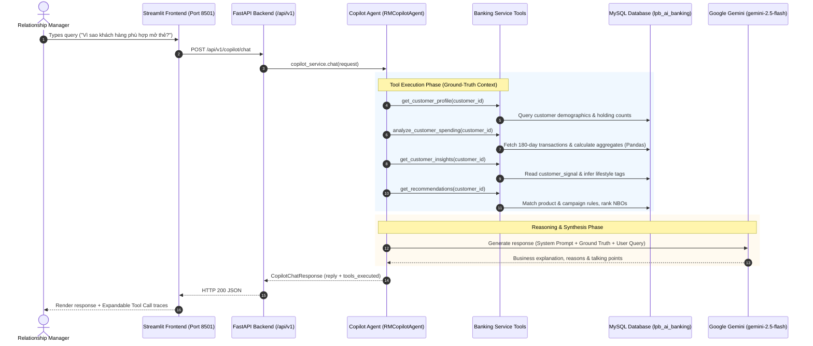

# AI Agent Workflow — LPBank AI RM Copilot

## 1. Overview
The **LPBank RM Copilot** employs a structured **ReAct-style (Reasoning + Acting)** and **Tool-Calling** pattern powered by the Google Gemini API (with deterministic fallback). The agent bridges non-technical natural language queries from Relationship Managers (RMs) with mathematically precise backend banking services.

---

## 2. Dynamic Tool Calling Specifications

### Tool 1: `get_customer_profile`
* **Purpose:** Retrieves demographic KYC, segment, managing branch, and product holding counts.
* **Input:** `customer_id: str`
* **Returned Fields:** `customer_id`, `customer_name`, `customer_segment`, `accounts_count`, `cards_count`, `loans_count`.

### Tool 2: `analyze_customer_spending`
* **Purpose:** Deterministic calculation of 180-day spending aggregates using Pandas.
* **Input:** `customer_id: str`
* **Returned Fields:** `total_spend_180d`, `avg_txn_amount`, `qr_payment_ratio`, `categories`, `monthly_trends`, `spending_growth_mom`.

### Tool 3: `get_customer_insights`
* **Purpose:** Behavioral signals and engagement indicators.
* **Input:** `customer_id: str`
* **Returned Fields:** `lifestyle_tags`, `engagement_status`, `churn_risk_level`, `signals`.

### Tool 4: `get_recommendations`
* **Purpose:** Next Best Offer (NBO) rankings matched with active bank campaigns.
* **Input:** `customer_id: str`
* **Returned Fields:** `primary_nbo`, `offers`, `total_eligible_offers`.

---

## 3. Grounding & Anti-Hallucination Guarantees
1. **Mathematical Determinism:** Totals, averages, and percentages are computed strictly in Python/Pandas before prompt generation.
2. **Catalog Confinement:** Only products and campaigns residing in `product_master` and `campaign_master` are suggested.
3. **Auditability:** Every tool invocation and its exact parameters are logged in `tools_executed` and presented in the UI.
4. **Fallback Resilience:** When Gemini API keys are unconfigured or network timeouts occur, the built-in deterministic rule engine answers immediately.

