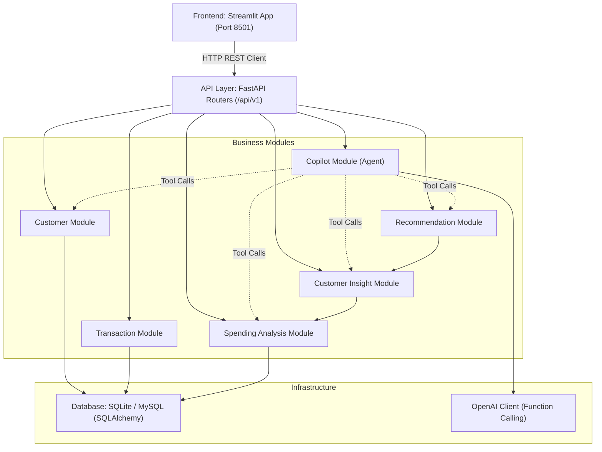

# Architecture Blueprint — LPBank AI RM Copilot

## 1. Architectural Style: Modular Monolith
The application is structured as a **Modular Monolith**. Rather than creating distributed microservices with complex network boundaries, each business domain is isolated into high-cohesion, low-coupling modules inside `backend/app/modules/`.

### Advantages for this Banking Demo:
1. **Clear Boundaries:** Modules communicate through public service interfaces.
2. **Simplified Deployment:** Single backend process and single frontend process.
3. **High Extensibility:** Ready to split into microservices if needed without re-architecting domain logic.
4. **Deterministic Auditing:** Banking calculations are strictly verified through deterministic Python modules before reaching the AI agent.

---

## 2. System Layers

---

## 3. End-to-End Workflow

1. **Customer Selection:** RM selects a customer (e.g. `CIF2026000001`) in the Streamlit frontend.
2. **Deterministic Processing:**
   - `Customer Module` fetches KYC demographics and segment.
   - `Spending Analysis Module` aggregates 180-day spending, merchant categories, and monthly trends using Pandas/SQL.
   - `Customer Insight Module` flags signals (`HIGH_QR_USAGE`, `DIGITAL_ACTIVE`, `SAVINGS_POTENTIAL`).
   - `Recommendation Module` applies rule matching against product and campaign catalogs to rank NBOs.
3. **Conversational Copilot (OpenAI Agent):**
   - RM asks questions (e.g. *"Why is this customer suitable for a cashback card?"*).
   - Agent dynamically invokes registered tools (`get_customer_profile`, `analyze_customer_spending`, `get_customer_insights`, `get_eligible_products`).
   - Agent synthesizes tool results and generates a professional, factual response with explicit business reasoning.

